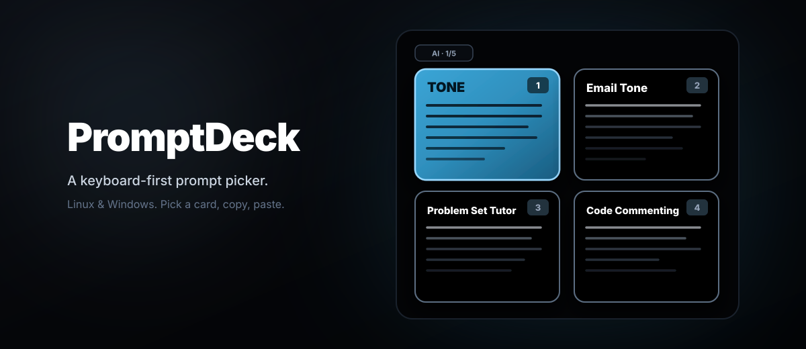

<p align="center">
  
</p>

# PromptDeck

PromptDeck puts saved prompts in a window over whatever you're working on; press your shortcut, pick one with the keyboard and then press `Enter`. The window will close with the text copied to your clipboard.

It works well for me when I need to reuse prompts with a chatbot or when I need to fetch personal details very quickly , granted that can be done with any simple script but having it multiple groups of information grouped in one place and only one keystroke away might also be very handy for you.

Demo:
https://github.com/user-attachments/assets/04bb1d76-82a7-4a04-bec7-3309483e1920

## Install

PromptDeck requires Python 3.10 or newer.

### Linux

```bash
curl -fsSL https://raw.githubusercontent.com/Paladin-Tier-2/PromptDeck/main/install.sh | sh
```

### Windows

```powershell
Invoke-WebRequest https://raw.githubusercontent.com/Paladin-Tier-2/PromptDeck/main/install.ps1 -OutFile install.ps1
powershell -ExecutionPolicy Bypass -File .\install.ps1
```

Rerunning either installer will update the tool.

The setup script lets you test it in a preview window to see how it looks.
To run setup again, use `promptdeck setup` or `promptdeck setup --terminal` (the flag `--yes` is also available). 

## Use
First, set up a global shortcut in your desktop setting (KDE,GNOME, or Windows), bind any you want to run `promptdeck`. It should work since it is will be available in your `PATH`.

On Linux, the setup installs a daemon `promptdeck.service` so the window pops up with less delay.

```bash
promptdeck service status
promptdeck service restart 
```

```bash
promptdeck                 # Open the overlay
promptdeck daemon          # Run daemon in terminal
promptdeck service restart # Restart background service
promptdeck service status  # Check service status
```

See [keyboard controls](KEYBINDINGS.md) for navigation.

## Your prompts (`decks.toml`)

Config lives in 

- Linux: `~/.config/promptdeck` (`$XDG_CONFIG_HOME/promptdeck`)
- Windows: `%APPDATA%\PromptDeck`

The text prompt lives in `decks.toml`, the deck refers to a group of cards ( the prompts); each prompt has a title, shortcut, and the text.

Example:

```toml
[[decks]]
name = "Writing"

[[decks.cards]]
title = "Make concise"
key = "C"
body = "Make this shorter without changing its meaning."
```

To organize prompts across multiple files and subdirectories, you can glob them in `decks.toml`:

```toml
include = [
    "decks/*.toml",
    "decks/*/*.toml"
]
```

```text
~/.config/promptdeck/
├── config.toml
├── decks.toml
└── decks/
    ├── 00-ai.toml
    ├── 10-coding.toml
    ├── 20-writing.toml
    └── personal.toml
```

Files load alphabetically, so numbering (`00-`, `10-`) controls deck order, while unnumbered files (`personal.toml`) or nested folders work out of the box. Edits take effect immediately without restarting the service.

## Appearance (`config.toml`)

Default color is based on the desktop's Qt palette. Change them in setup or edit `config.toml`. Use `"system"` for a desktop color or whatever you want in hex notation:

```toml
version = 1
deck_source = "decks.toml"

[appearance]
selected_background = "system" # or "#7c3aed"
selected_border = "system"
card_background = "system"
card_border = "system"
card_text = "system"
```

## More
You can pass a custom config anytime with `promptdeck --config /path/to/config.toml`

## Development

```bash
python -m pip install -e .
python -m unittest discover -s tests -v
python -m build
```
